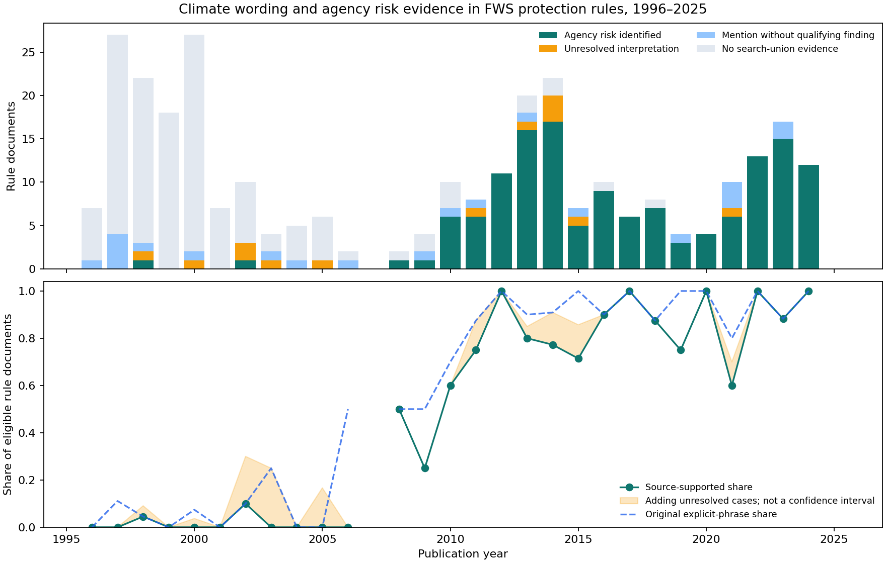

# Climate change in ESA listing decisions

[](https://github.com/yanghong-liu/espm157-text-as-data/actions/workflows/main.yml)

ESPM 157, Module 3 — built from [espm-157/text-template](https://github.com/espm-157/text-template).

## Team

- Yanghong Liu — [@yanghong-liu](https://github.com/yanghong-liu)
- [@chunminzheng](https://github.com/chunminzheng)

## Question

How often do FWS final listing rules identify climate change as a threat, and how has this
changed over time? We study 1996–2025, include animals and plants, and count one rule document
as one observation. The scope includes first final listings and decisions adding previously
unprotected populations or areas. It excludes pure similarity-of-appearance protection, status
changes, taxonomic reorganizations, and unrelated actions. First permanent listings after
temporary emergency protection can qualify. Foreign taxa are included.

## Findings

The metadata query returned 1,534 FWS rules. Of 296 original title-selected candidates, 269
qualify and 27 do not. Another 55 source inspections add 34 eligible rules, giving a final
corpus of **303 documents**. The source audit records all 351 inspections with evidence.

The original explicit-phrase search matches 160 rules. Expanded retrieval finds 2,515 passages
in 174 documents. The saved source interpretations identify an agency climate-risk contribution
in **140 of 303 rules (46.2%)**, with 13 uncertain cases, 21 mention-only cases, and 129 without
retrieved evidence. A guided check resolves one initially uncertain rule as a risk finding.
No search hit does not establish an absence of climate risk.

The supported share rises from 2/133 in 1996–2005 to 63/86 in 2006–2015 and 75/84 in 2016–2025.
This is a descriptive pattern; changes in species, documents, and wording can affect it.



Excluding new-range protection gives 139/297 (46.8%). Counting all unresolved interpretations
as positive gives 153/303 (50.5%). These are sensitivity scenarios, not confidence intervals.

Five cases are compared with Delach et al.'s independent animal-species data after checking
the listing targets. Different documents, years, units, and outcomes prevent treating this
small comparison as an accuracy estimate. The notebook explains the methods, judgment sources,
source examples, and limits. No representative classification accuracy is claimed.

## Run

Use Python 3.11 or later in an isolated environment, or the course DataHub:

```bash
python -m pip install -r requirements.txt
```

Open `esa.ipynb` from this repository, select the environment's Python kernel, and restart
the kernel and run all cells. No API credentials are needed. The notebook checks and replays
saved source-linked classifications; it does not call a model again.

Raw texts download to the ignored `data/` directory. New downloads use official GovInfo
documents with Federal Register raw text as a fallback. Transient failures are retried;
missing text stops the analysis. Metadata, query URLs, checksums, and independent data are
saved in `sources/`. Refreshing the metadata requires repeating the corpus audit.

To reproduce the eligibility and coverage checks from a fresh clone:

```bash
python coverage_check.py
python corpus_audit.py --download
```

Then run the notebook and the course's lightweight check:

```bash
python .github/check_notebooks.py
```

## Files

- `esa.ipynb`: executed analysis, source cases, figures, and conclusion.
- `esa_tools.py`, `corpus_audit.py`, `coverage_check.py`, `climate_evidence.py`: analysis helpers.
- `sources/`: metadata snapshot, independent data, and retrieval records.
- `review/corpus_audit.csv`: eligibility decisions and evidence for 351 inspected documents.
- `review/corpus_policy.json`: the two scope definitions.
- `review/document_classifications.csv`: 174 document classifications with reasons and evidence.
- `review/passage_labels.csv`: two guided checks and the puffleg document resolution.
- `review/independent_source_cases.csv`: five Delach comparisons with source evidence.
- `results/`: current result tables and figures.
- `prompts/`: English translations of assignment conversation snapshots.
- `DISCLOSURE.md`: original instructor-template provenance.

## Sources

- [Federal Register API](https://www.federalregister.gov/developers/documentation/api/v1)
- [GovInfo archive](https://www.govinfo.gov/app/collection/FR)
- [Delach et al. (2019)](https://doi.org/10.1038/s41558-019-0620-8)
- [Independent open data](https://doi.org/10.17605/OSF.IO/R9UCA)
